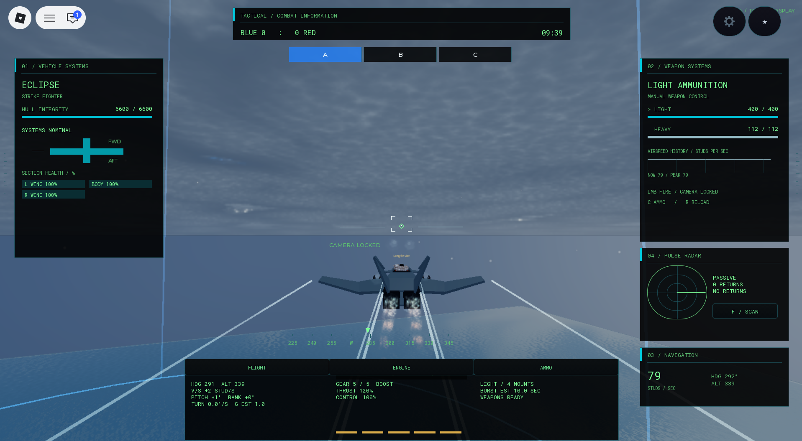
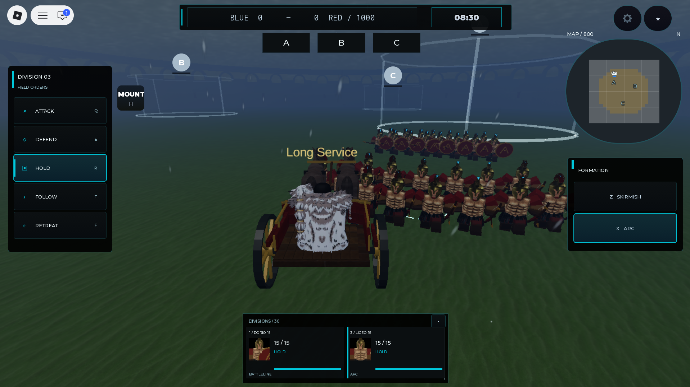
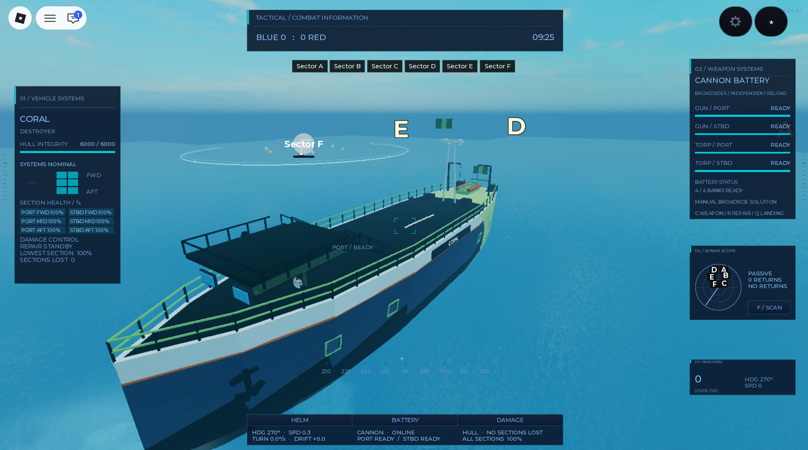
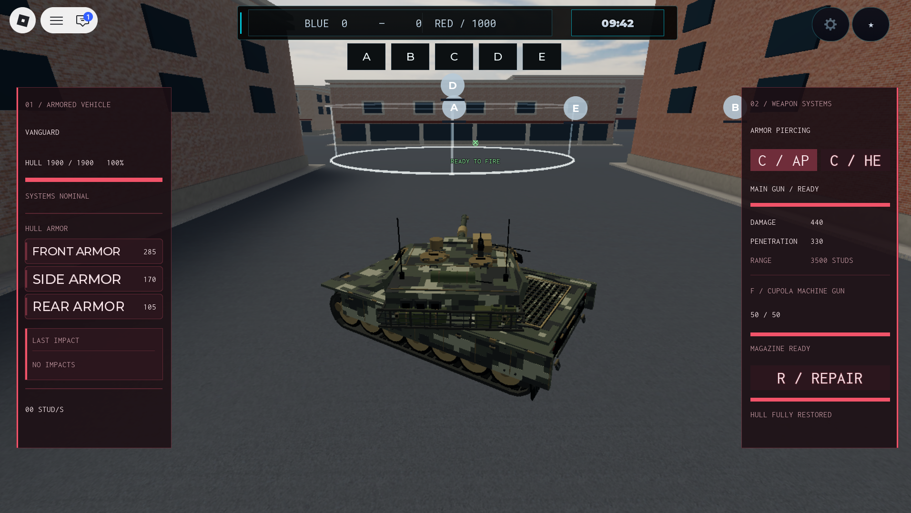

# Gameplay screenshot gallery

Player-perspective captures from Nocturnal Sand Box. Select any image to open it at full resolution.

## Air combat · Eclipse

The Eclipse strike fighter flies over open water with its camera locked. The HUD shows wing and fuselage integrity, light and heavy ammunition, pulse radar, and flight telemetry alongside the team's capture objectives.

## Ground combat · Infantry formations

Two infantry divisions hold position by the objectives, one in a battleline and the other in an arc. The command panel shows the selected division's field orders, while the minimap and unit cards track objectives and troop strength.

## Naval combat · Coral

The Coral destroyer is shown near Sector F. Its HUD tracks damage across six hull sections and shows separate readiness indicators for port and starboard cannons and torpedoes, alongside sonar and navigation.

## Tanks · Vanguard

The Vanguard faces a capture point on an urban map. The HUD shows front, side, and rear armor values, the selected armor-piercing round, and the readiness of the main gun, cupola machine gun, and repairs.

## Planned captures

| Subject | Destination |
| --- | --- |
| Shore deployment on Twin Islands | `landing-operations/twin-islands-deployment.png` |
| Ships and infantry on the same shoreline | `amphibious-combat/shore-assault.png` |
| Troops crossing between ships | `boarding/ship-to-ship-boarding.png` |
